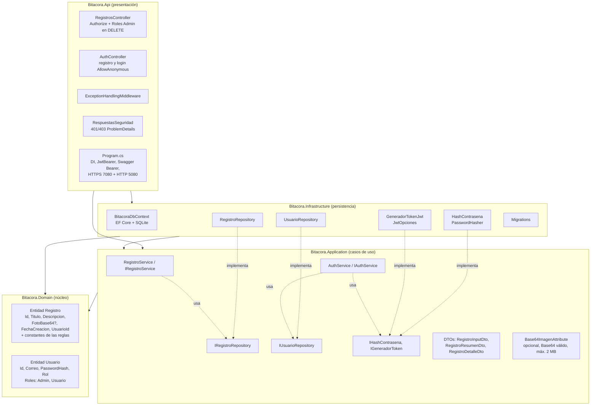
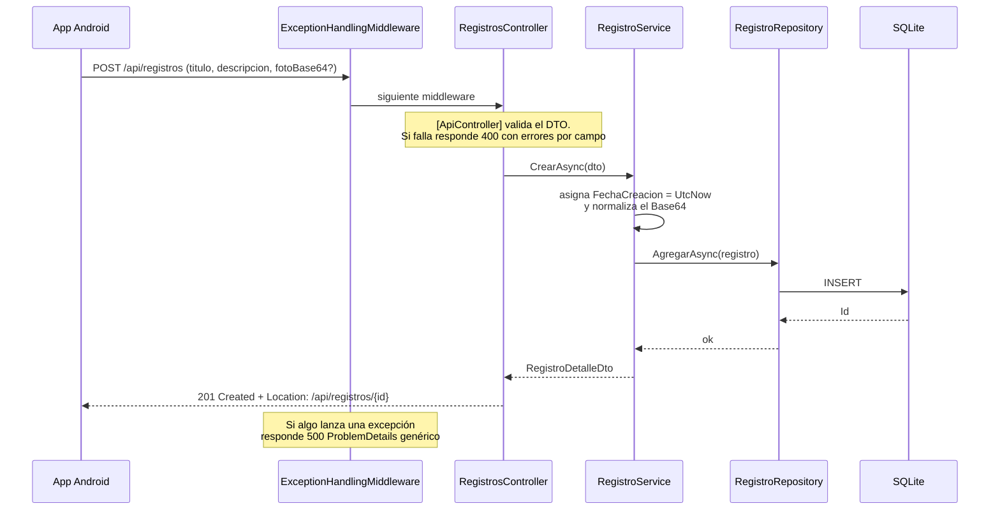

# Arquitectura

La solución `Bitacora.sln` sigue una arquitectura por capas (estilo *Clean Architecture*):
**todas las dependencias apuntan hacia el dominio**, y el dominio no depende de nadie.

## Capas y dependencias entre proyectos

| Proyecto                  | Referencia a                       | Contiene |
|---------------------------|------------------------------------|----------|
| `Bitacora.Domain`         | (ninguno)                          | Entidades `Registro` y `Usuario`, constantes `Roles` y las reglas del negocio (longitudes, tamaño máximo de la foto, contraseña mínima). Sin interfaces ni dependencias |
| `Bitacora.Application`    | Domain                             | DTOs, interfaces `IRegistroRepository`, `IUsuarioRepository`, `IHashContrasena`, `IGeneradorToken`, validación, `RegistroService` (regla del dueño) y `AuthService` (registro, login, Admin semilla) |
| `Bitacora.Infrastructure` | Application, Domain                | `BitacoraDbContext`, repositorios, `HashContrasena` (`PasswordHasher`), `GeneradorTokenJwt`, `JwtOpciones`, migraciones, `AddInfraestructura()` |
| `Bitacora.Api`            | Application, Infrastructure        | Controladores, `JwtBearer`, respuestas 401/403, middleware de errores, Swagger con Bearer, HTTPS, composición de dependencias |

`Bitacora.Api` referencia a Infrastructure solo para registrar las implementaciones en el contenedor de DI
(*composition root*). El controlador trabaja únicamente con `IRegistroService`.

## Flujo de una petición

## Decisiones

- **`IRegistroRepository` vive en Application**, que es quien la necesita. Así el dominio no conoce
  la persistencia ni depende de nadie. Infrastructure la implementa (por eso referencia a Application).
- **Foto como `FotoBase64` (TEXT, opcional)**, igual que en la entidad del enunciado. Si se envía, se valida que sea
  Base64 válido, no vacío y de 2 MB o menos decodificados. Se guarda en forma canónica (sin el prefijo `data:`).
- **La lista no devuelve la foto.** El repositorio proyecta las columnas sin leer `FotoBase64` y solo calcula
  `tieneFoto`, así la lista es liviana para el `RecyclerView` de Android. La foto se pide con `GET /api/registros/{id}`.
- **Errores en formato ProblemDetails (RFC 9110):** 400 con `errors` por campo, 404 y 500 sin detalles internos.
- **`FechaCreacion` en UTC** asignada por el servidor. No está en el DTO de entrada y PUT no la modifica.
- **Seguridad detrás de interfaces (tarea 2.4).** Application solo conoce `IHashContrasena` e `IGeneradorToken`;
  las implementaciones con `PasswordHasher` y `System.IdentityModel.Tokens.Jwt` están en Infrastructure. La regla
  "un Usuario solo modifica sus registros" vive en `RegistroService`, no en el controlador.
- **El usuario actual sale del token.** El controlador lee `sub` y `role` (`ClaimsPrincipalExtensions`) y los pasa al
  servicio como `UsuarioActual`. Detalle completo en [../../docs/seguridad-jwt.md](../../docs/seguridad-jwt.md).
