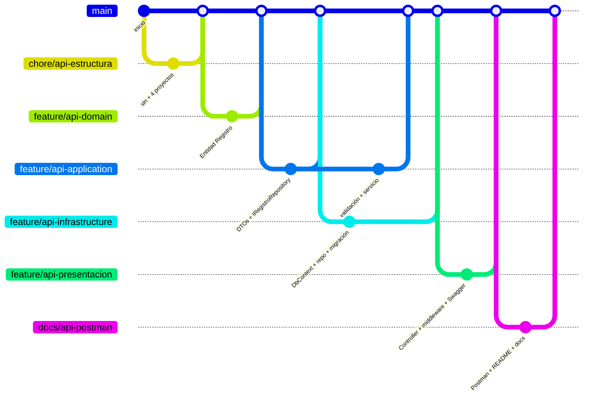

# Propuesta de reparto del trabajo por ramas

Cada capa vive en su propio proyecto, así que se puede trabajar en paralelo con pocos conflictos.
Propuesta: **una rama por capa**, integradas en `main` mediante Pull Request y en el orden de las dependencias.

## Ramas

| # | Rama                          | Contenido                                                                 | Depende de |
|---|-------------------------------|---------------------------------------------------------------------------|------------|
| 0 | `chore/api-estructura`        | `.gitignore`, `Bitacora.sln`, los 4 `.csproj` vacíos con sus referencias  | (ninguna)  |
| 1 | `feature/api-domain`          | Entidad `Registro` y constantes de las reglas                             | 0          |
| 2 | `feature/api-application`     | DTOs, `IRegistroRepository`, `Base64ImagenAttribute`, `IRegistroService`, `RegistroService` | 1          |
| 3 | `feature/api-infrastructure`  | `BitacoraDbContext`, `RegistroRepository`, `AddInfraestructura`, migración inicial | 1 y 2 |
| 4 | `feature/api-presentacion`    | `RegistrosController`, `ExceptionHandlingMiddleware`, `Program.cs`, `appsettings`, Swagger | 2, 3 |
| 5 | `docs/api-postman`            | `postman/`, `README.md`, `docs/`                                          | 4          |

## Reparto sugerido (2 integrantes)

| Integrante | Ramas                                                          |
|------------|----------------------------------------------------------------|
| A          | `chore/api-estructura`, `feature/api-domain`, `feature/api-application` |
| B          | `feature/api-infrastructure`, `feature/api-presentacion`       |
| Ambos      | `docs/api-postman`: A escribe README/docs y B la colección Postman |

Las ramas 2 y 3 pueden avanzar en paralelo: primero se integra en `main` un PR corto de la rama 2 con los DTO y la
interfaz `IRegistroRepository` (Application), que es el contrato entre ambas. Después A sigue con la validación y el
servicio mientras B implementa el repositorio.

## Reglas

- Partir siempre de `main` actualizado: `git switch main && git pull && git switch -c feature/...`.
- Antes de abrir el PR: `dotnet build Bitacora.sln` sin errores. Desde la rama 4 en adelante, también correr la colección Postman.
- Commits pequeños con mensaje en imperativo, por ejemplo `Agrega validador Base64 de 2 MB`.
- La app Android (`app/`) **no se toca** en estas ramas. Su consumo de la API (tareas 2.3-2.5) va en ramas aparte (`feature/android-...`).
- No se suben `bin/`, `obj/` ni `*.db` (ya están en `BitacoraApi/.gitignore`).
