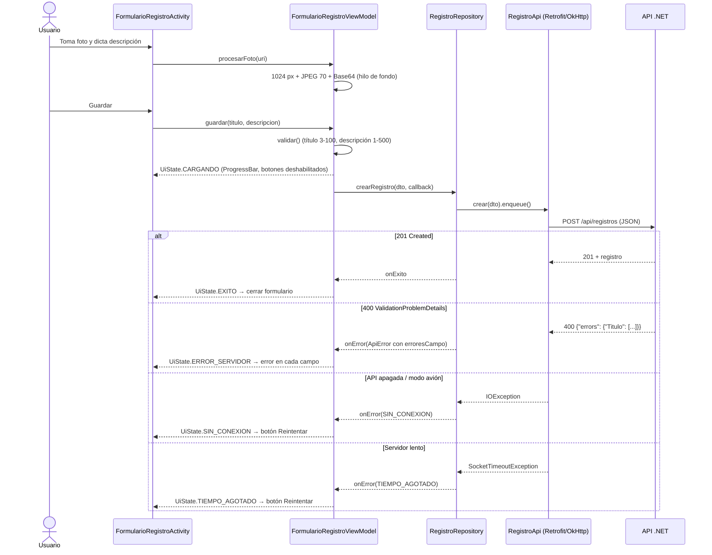

# App Android – Flujo de una petición (Tarea 2.3)

La app `app/` (Java, MVVM) consume la API REST de la Bitácora de campo (`BitacoraApi/`, tarea 2.2)
mediante Retrofit + OkHttp.

## 1. Capas y paquetes (`com.uth.exa1pa1199`)

| Capa | Paquete | Clases | Responsabilidad |
|---|---|---|---|
| Vista | `ui` | `ListaRegistrosActivity`, `DetalleRegistroActivity`, `FormularioRegistroActivity`, `RegistroAdapter`, `UiHelper` | Solo muestran el estado y envían eventos (clics, foto, voz) al ViewModel. **Ninguna llama a Retrofit.** |
| Lógica de pantalla | `viewmodel` | `ListaRegistrosViewModel`, `DetalleRegistroViewModel`, `FormularioRegistroViewModel`, `UiState` | Validan, preparan la foto y exponen `LiveData<UiState<T>>`. |
| Repositorio | `data/repository` | `RegistroRepository`, `ApiError`, `RepositorioCallback`, `Cancelable` | **Única clase que llama a la API.** Traduce códigos HTTP y excepciones a `ApiError`. |
| Acceso remoto | `data/remote` | `RegistroApi`, `ApiClient`, `dto/*` | Interfaz Retrofit, configuración de OkHttp y DTO JSON (Gson). |
| Utilidades | `util` | `ImagenUtils`, `FechaUtils` | Reducción a 1024 px / JPEG 70 / Base64 y formato de fecha. |

## 2. Diagrama del flujo

```mermaid
flowchart LR
    subgraph Vista["Vista (ui)"]
        A[Activity / RecyclerView]
    end
    subgraph VM["ViewModel (viewmodel)"]
        B["ViewModel<br/>LiveData&lt;UiState&gt;"]
    end
    subgraph Repo["Repositorio (data/repository)"]
        C[RegistroRepository]
    end
    subgraph Remote["Retrofit (data/remote)"]
        D["RegistroApi<br/>(Retrofit + Gson)"]
        E["OkHttpClient<br/>timeouts + HttpLoggingInterceptor"]
    end
    F[("API REST<br/>http://10.0.2.2:5080/api/registros")]

    A -- "evento: cargar() / guardar() / eliminar()" --> B
    B -- "llama método + callback" --> C
    C -- "Call&lt;T&gt;.enqueue()" --> D
    D --> E
    E -- "HTTP JSON" --> F
    F -- "200/201/204 o 4xx/5xx" --> E
    E --> D
    D -- "Response&lt;T&gt; / Throwable" --> C
    C -- "onExito(T) / onError(ApiError)" --> B
    B -- "setValue(UiState)" --> A
```



### Secuencia de ejemplo: crear un registro



## 3. Endpoints consumidos (`RegistroApi`)

| Método | Ruta | Anotaciones | Respuesta esperada | Uso en la app |
|---|---|---|---|---|
| GET | `api/registros` | `@GET` | 200 + lista | Listado |
| GET | `api/registros/{id}` | `@GET` + `@Path` | 200 + `fotoBase64` | Detalle y carga del formulario de edición |
| POST | `api/registros` | `@POST` + `@Body` | 201 | Crear |
| PUT | `api/registros/{id}` | `@PUT` + `@Path` + `@Body` | 204 | Editar |
| DELETE | `api/registros/{id}` | `@DELETE` + `@Path` | 204 | Eliminar (tras diálogo de confirmación) |

## 4. Estados de pantalla (`UiState.Estado`)

| Estado | Cómo se detecta (en `RegistroRepository`) | Qué se muestra |
|---|---|---|
| `CARGANDO` | Antes de `enqueue()` | ProgressBar visible, botones deshabilitados |
| `EXITO` | `response.isSuccessful()` | Datos |
| `VACIO` | 200 con lista vacía | Texto "Aún no hay registros" |
| `ERROR_SERVIDOR` | `!response.isSuccessful()` (4xx/5xx) | Mensaje comprensible por código (400, 404, 413, 5xx…) y errores por campo en el formulario |
| `TIEMPO_AGOTADO` | `onFailure` con `SocketTimeoutException` | Mensaje + botón **Reintentar** |
| `SIN_CONEXION` | `onFailure` con cualquier otra `IOException` | Mensaje + botón **Reintentar** |

> `SocketTimeoutException` hereda de `IOException`, por eso se evalúa primero.

## 5. Configuración de OkHttp

- `connectTimeout` = 10 s, `readTimeout` = 20 s, `writeTimeout` = 20 s (`ApiClient`).
- `HttpLoggingInterceptor` con nivel `BODY` **solo si `BuildConfig.DEBUG`**. En Logcat filtrar por la etiqueta
  `okhttp.OkHttpClient` para ver peticiones y respuestas (capturas para el documento PDF).
- La URL base está en `BuildConfig.API_BASE_URL` (definida en `app/build.gradle.kts`, `buildConfig = true`).

## 6. `network_security_config` (tráfico HTTP sin cifrar)

Desde Android 9 (API 28) las apps **bloquean por defecto el tráfico HTTP sin cifrar** (*cleartext*).
Durante el desarrollo la API corre en `http://` (sin TLS) en la máquina local, así que hay que permitirlo,
pero **solo** para los hosts de desarrollo:

```xml
<!-- app/src/main/res/xml/network_security_config.xml -->
<network-security-config>
    <base-config cleartextTrafficPermitted="false" />
    <domain-config cleartextTrafficPermitted="true">
        <domain includeSubdomains="false">10.0.2.2</domain>
        <domain includeSubdomains="false">localhost</domain>
    </domain-config>
</network-security-config>
```

Y en el manifiesto: `android:networkSecurityConfig="@xml/network_security_config"`.

- `base-config cleartextTrafficPermitted="false"`: cualquier otro dominio **debe** usar HTTPS.
- `10.0.2.2`: dirección especial del emulador de Android que apunta al `localhost` del PC donde corre la API.
- `localhost`: para un dispositivo físico conectado por USB usando `adb reverse tcp:5080 tcp:5080`.
- No se usa `android:usesCleartextTraffic="true"` porque abriría HTTP para **todos** los dominios.
- En producción la API se publicaría con HTTPS y este `domain-config` se eliminaría.

### Permiso `ACCESS_LOCAL_NETWORK` (Android 17 / API 37+)

`network_security_config` solo decide **si se permite HTTP sin cifrar**; no basta en Android 17. Con
`targetSdk = 37` entra en vigor **Local Network Protection**: el sistema bloquea por defecto cualquier conexión
a direcciones de la red local (`10.0.2.2`, `192.168.x.x`, `localhost` vía `adb reverse`…) y la petición no
falla con un error claro, sino que se queda colgada hasta que OkHttp lanza `SocketTimeoutException`
(estado `TIEMPO_AGOTADO`). Son dos capas independientes y hacen falta **las dos**:

| Capa | Qué controla | Dónde |
|---|---|---|
| `network_security_config` | Permitir `http://` (cleartext) solo para `10.0.2.2` y `localhost` | `res/xml/network_security_config.xml` |
| `ACCESS_LOCAL_NETWORK` | Permitir conexiones a la red local (Android 17+) | Manifiesto + solicitud en tiempo de ejecución |

```xml
<!-- AndroidManifest.xml -->
<uses-permission android:name="android.permission.ACCESS_LOCAL_NETWORK" />
```

Es un permiso **de tiempo de ejecución**, así que declararlo no basta: `ListaRegistrosActivity` (pantalla de
inicio) lo gestiona antes de la primera carga:

1. En `onStart()` llama a `cargarSiHayPermiso()`. En Android < 17 (`SDK_INT < 37`) carga directamente.
2. En API 37+ comprueba `ContextCompat.checkSelfPermission(...)`. Si ya está concedido, carga la lista.
3. Si no, lo solicita con `ActivityResultContracts.RequestPermission`. Al concederlo, llama a
   `viewModel.cargar()`.
4. Si lo niega, se muestra (reutilizando `view_estado_error`) un mensaje explicando que la app necesita acceso a
   la red local para conectarse a la API, con el botón **Conceder permiso** para volver a pedirlo. Si el
   sistema ya no muestra el diálogo (denegado de forma permanente), el botón pasa a **Abrir ajustes**; al
   volver, `onStart()` vuelve a comprobar el permiso.

El permiso se concede **a la app entera**, no a una Activity: como el detalle y el formulario solo se abren
desde la lista, cuando el usuario llega a ellos el permiso ya está concedido y sus peticiones funcionan sin
código adicional.

## 7. Foto y voz

- **Foto**: `ActivityResultContracts.TakePicture` guarda la imagen en `cacheDir/foto_temp.jpg` a través del
  `FileProvider` del primer parcial (`${applicationId}.provider`, `res/xml/file_paths.xml`).
  `ImagenUtils.reducirYCodificar` la reduce a máx. **1024 px**, corrige la rotación EXIF, la comprime a
  **JPEG calidad 70** y la convierte a Base64 (`NO_WRAP`); se rechaza si supera 2 MB.
- **Visualización** (formulario y detalle): el `ImageView` muestra la foto **completa, sin recortes**:

  ```xml
  android:layout_width="match_parent"
  android:layout_height="wrap_content"
  android:adjustViewBounds="true"   <!-- la altura sigue la proporción de la imagen -->
  android:maxHeight="300dp"         <!-- tope; solo funciona con adjustViewBounds="true" -->
  android:scaleType="fitCenter"     <!-- escala para que quepa entera (centerCrop la recortaba) -->
  ```

  En el formulario además `android:minHeight="160dp"`, para que mientras no hay foto el icono de cámara quede
  centrado en un área amplia y no en un hueco de unos pocos dp.
- **Voz**: `RecognizerIntent.ACTION_RECOGNIZE_SPEECH` con `EXTRA_LANGUAGE = "es-ES"`; el texto reconocido se
  agrega a la descripción. Se solicita el permiso `RECORD_AUDIO` en tiempo de ejecución.

## 8. Edge-to-edge y `WindowInsets` (barra de estado, título, navegación y teclado)

Con `targetSdk` 35 o superior (aquí 37), Android 15+ aplica **edge-to-edge obligatorio**: la ventana se dibuja
detrás de la barra de estado y de la barra de navegación, y `adjustResize` ya no encoge la ventana al abrir el
teclado. Si la app no reserva ese espacio, el contenido queda tapado: la foto y el título quedaban debajo de la
barra de estado / barra del título, el botón (+) debajo de la barra de navegación y el teclado tapaba los
campos del formulario.

### Barra de título propia

El `ActionBar` que pone el tema por defecto no permite controlar bien dónde empieza el contenido en
edge-to-edge, así que se reemplazó por una barra incluida en cada layout:

- Tema: `Theme.Material3.DayNight.NoActionBar` (`res/values/themes.xml` y `res/values-night/themes.xml`).
- `res/layout/view_toolbar.xml`: `AppBarLayout` (`@id/appBar`) con un `MaterialToolbar` (`@id/toolbar`).
- Los tres layouts (`activity_lista_registros`, `activity_detalle_registro`, `activity_formulario_registro`)
  tienen la misma estructura:

```
LinearLayout vertical  (@id/root)   ← padding izq./der./inferior = barra de navegación o teclado
├── <include view_toolbar>  (@id/appBar)  ← padding superior = barra de estado / notch
└── contenido (CoordinatorLayout o FrameLayout, height 0dp + weight 1)
    └── ScrollView / RecyclerView / FAB / ProgressBar / vista de error
```

Como el contenido va **debajo** de la AppBar dentro de un `LinearLayout` vertical, siempre empieza bajo la
barra del título (incluido el `ScrollView` del formulario), sin márgenes calculados a mano.

### `UiHelper`

Cada Activity hace, en `onCreate`:

```java
UiHelper.activarEdgeToEdge(this);            // antes de super.onCreate / setContentView
super.onCreate(savedInstanceState);
setContentView(R.layout.activity_...);
UiHelper.configurarPantalla(this, true);     // false en la lista (no tiene botón volver)
setTitle(R.string.titulo_...);               // después: el título va al MaterialToolbar
```

- `activarEdgeToEdge` llama a `EdgeToEdge.enable(activity)` (androidx.activity). Así la app se comporta igual en
  todas las versiones (en Android < 15 también es edge-to-edge) y el sistema ajusta el contraste de los iconos
  de las barras.
- `configurarPantalla` hace `setSupportActionBar(toolbar)`, activa el botón volver si se pide
  (`onSupportNavigateUp()` hace `finish()`) y registra un `ViewCompat.setOnApplyWindowInsetsListener` en
  `@id/root`:

| Vista | Padding | Insets usados |
|---|---|---|
| `appBar` | superior | `systemBars() \| displayCutout()` → barra de estado / notch |
| `root` | izquierdo y derecho | `systemBars() \| displayCutout()` → navegación lateral en horizontal |
| `root` | inferior | `systemBars() \| displayCutout() \| ime()` → barra de navegación **o** teclado |

`getInsets()` con varios tipos devuelve el **máximo por lado**, por eso el padding inferior es la altura del
teclado cuando está abierto y la de la barra de navegación cuando está cerrado. El listener devuelve
`WindowInsetsCompat.CONSUMED` para que ningún hijo vuelva a sumar los mismos insets.

Resultado en cada pantalla:

- **Lista**: el (+) (`layout_gravity="bottom|end"` + margen de 16dp) queda por encima de la barra de navegación;
  la última tarjeta no queda tapada gracias al `paddingBottom="88dp"` + `clipToPadding="false"` del
  `RecyclerView`.
- **Detalle**: la foto y el título empiezan bajo la barra del título; los botones Editar / Eliminar se pueden
  desplazar por encima de la barra de navegación.
- **Formulario**: al abrir el teclado el `ScrollView` se reduce y desplaza el campo enfocado a la zona visible,
  de modo que el teclado no tapa los campos ni el botón Guardar.

