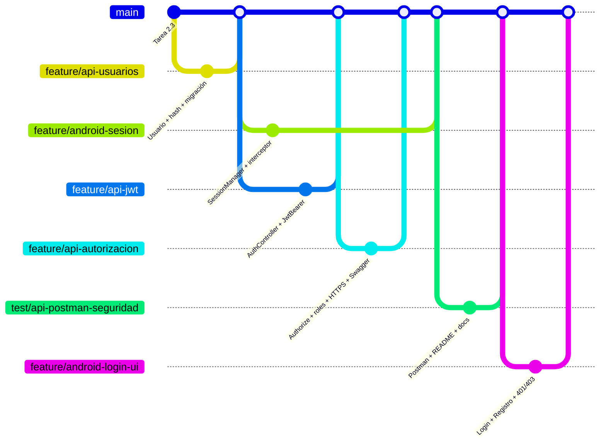

# Reparto del trabajo – Tarea 2.4 (6 integrantes)

Cada integrante trabaja en una rama que sale de `main` actualizado y abre un Pull Request.
El orden está pensado para que **después de cada merge todo compile**: `dotnet build Bitacora.sln` en `BitacoraApi/`
y `.\gradlew assembleDebug` en la raíz. La API y la app son compilaciones independientes, así que la parte
Android (pasos 5 y 6) puede avanzar en paralelo con la API.

## Ramas y contenido

| # | Integrante | Rama | Archivos | Depende de |
|---|---|---|---|---|
| 1 | Integrante 1 | `feature/api-usuarios` | **Domain:** `Entities/Usuario.cs`, `Entities/Roles.cs`, `UsuarioId` y navegación en `Registro.cs`. **Application:** `Interfaces/IUsuarioRepository.cs`, `Seguridad/IHashContrasena.cs`. **Infrastructure:** `Seguridad/HashContrasena.cs` (`PasswordHasher`), `Repositories/UsuarioRepository.cs`, tabla `Usuarios` + índice único + FK en `BitacoraDbContext`, paquete `Microsoft.Extensions.Identity.Core`, migración `UsuariosYPropietario`, registro en `AddInfraestructura` | — |
| 2 | Integrante 2 | `feature/api-jwt` | **Application:** `DTOs/AuthDtos.cs`, `Seguridad/IGeneradorToken.cs`, `Services/IAuthService.cs`, `Services/AuthService.cs`. **Infrastructure:** `Seguridad/JwtOpciones.cs`, `Seguridad/GeneradorTokenJwt.cs`, paquete `System.IdentityModel.Tokens.Jwt`. **Api:** `Controllers/AuthController.cs`, `Seguridad/RespuestasSeguridad.cs`, en `Program.cs` `AddAuthentication().AddJwtBearer(...)` con sus eventos 401/403, migración al iniciar y Admin semilla; sección `Jwt` en `appsettings.json`; `UserSecretsId` en el `.csproj` | 1 |
| 3 | Integrante 3 | `feature/api-autorizacion` | **Application:** `Seguridad/UsuarioActual.cs`, `Services/ResultadoOperacion.cs`, cambios en `IRegistroService`/`RegistroService` (dueño del registro y regla del PUT), `UsuarioId` en los DTO. **Infrastructure:** proyección de `UsuarioId` en `RegistroRepository`. **Api:** `[Authorize]` y `[Authorize(Roles = "Admin")]` en `RegistrosController`, `Seguridad/ClaimsPrincipalExtensions.cs`, `Seguridad/SeguridadSwaggerFilter.cs` (botón Authorize), HTTPS 7080 + `UseHttpsRedirection` + `HostsSinRedireccionHttps` en `appsettings*.json` | 2 |
| 4 | Integrante 4 | `test/api-postman-seguridad` | `postman/Bitacora.postman_collection.json` (carpeta Auth, token heredado de la colección, las 6 pruebas obligatorias), `postman/Bitacora.postman_environment.json` (`baseUrl` HTTPS y variables secretas), `BitacoraApi/README.md` (user-secrets, HTTPS, endpoints de auth), `BitacoraApi/docs/arquitectura.md`, secciones 2 a 7 y 10 de `docs/seguridad-jwt.md` | 3 |
| 5 | Integrante 5 | `feature/android-sesion` | `gradle/libs.versions.toml` y `app/build.gradle.kts` (`security-crypto`), `BitacoraApp.java` y `android:name` en el manifiesto, `data/session/SessionManager.java`, `data/remote/AuthInterceptor.java`, `AuthApi.java`, `ApiClient.java` (interceptor y `redactHeader`), `dto/CredencialesDto`, `TokenDto`, `UsuarioDto`, `data/repository/ApiErrorMapper.java`, `AuthRepository.java`, refactor de `RegistroRepository.java`, tipos `NO_AUTENTICADO`/`PROHIBIDO` en `ApiError` y estados en `UiState`, `backup_rules.xml` y `data_extraction_rules.xml`, `FechaUtils.aMilisegundos` | — (compila sin la API) |
| 6 | Integrante 6 | `feature/android-login-ui` | `viewmodel/LoginViewModel.java`, `RegistroUsuarioViewModel.java`, cambios en `ListaRegistrosViewModel` (cerrar sesión) y `DetalleRegistroViewModel` (`puedeEliminar`), `ui/SesionActivity.java`, `LoginActivity.java`, `RegistroUsuarioActivity.java`, `PermisoRedLocal.java`, `activity_login.xml`, `activity_registro_usuario.xml`, `menu/menu_lista.xml`, strings, cambios en Lista/Detalle/Formulario/`UiHelper` (401, 403, ocultar Eliminar), LAUNCHER a `LoginActivity`, `README.md` raíz, sección 8 de `docs/seguridad-jwt.md` | 5 |

La sección 9 (OAuth 2.0) de `docs/seguridad-jwt.md` y este archivo los escriben juntos los integrantes 4 y 6.

## Orden de merge y por qué compila en cada paso

1. **api-usuarios** → solo agrega la entidad, el repositorio, el hash y la migración. Ningún endpoint cambia todavía.
   `Registro.UsuarioId` existe pero el servicio aún no lo llena, por eso en este paso **se borra `bitacora.db`** y no se
   crean registros hasta el paso 3.
2. **api-jwt** → usa `IUsuarioRepository` e `IHashContrasena` del paso 1. La API ya emite tokens, pero
   `/api/registros` sigue abierto. Cada integrante debe ejecutar los comandos de `dotnet user-secrets` del README
   (sin `Jwt:Key` la API no arranca).
3. **api-autorizacion** → cambia la firma de `IRegistroService` y su único consumidor (`RegistrosController`) en el
   mismo PR, así que nunca queda una llamada rota. Desde aquí el emulador debe enviar token: hasta el paso 6 la app
   recibe 401 (esperado).
4. **api-postman-seguridad** → solo archivos JSON y Markdown; se valida ejecutando la colección contra la API del paso 3.
5. **android-sesion** → agrega clases nuevas y estados nuevos a `UiState`. Las pantallas existentes no los usan aún,
   pero compilan porque los `switch` sobre el enum no son exhaustivos. Se puede integrar en cualquier momento.
6. **android-login-ui** → usa `SessionManager`, `AuthRepository` y los estados del paso 5. En el mismo PR se cambia
   el LAUNCHER a `LoginActivity`, para que el manifiesto nunca apunte a una clase inexistente.

## Video y documento PDF

| Tarea | Responsables |
|---|---|
| Guion y grabación del video (3–5 min): login, uso normal, intento de borrar sin ser Admin, vencimiento del token, cierre de sesión | Integrantes 5 y 6 |
| Capturas de Postman (6 pruebas) y de jwt.io con el token decodificado | Integrantes 3 y 4 |
| Documento PDF a partir de `docs/seguridad-jwt.md` + capturas | Integrantes 1 y 2 |
| Revisión final: que no haya claves en el repositorio (`git log -p | Select-String "Jwt:Key"`) | Todos |

## Reglas

- Partir de `main` actualizado: `git switch main; git pull; git switch -c feature/...`.
- Antes de abrir el PR: `dotnet build Bitacora.sln` (API) o `.\gradlew assembleDebug` (app) sin errores; desde el
  paso 3, ejecutar también la colección de Postman.
- **Nunca** subir `secrets.json`, claves ni contraseñas reales. Si pasa, generar una clave nueva (ver
  `docs/seguridad-jwt.md`, sección 4) y avisar al equipo.
- `strings.xml`, `AndroidManifest.xml` y `Program.cs` los tocan varias ramas: agregar al final de su sección y hacer
  `git pull --rebase origin main` antes de abrir el PR.
- Cada PR lo revisa al menos otro integrante.
