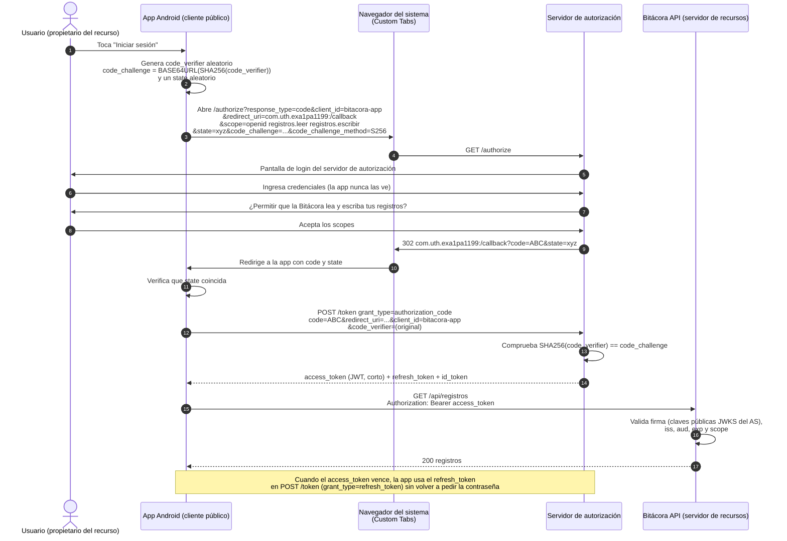

# Seguridad de la API con JWT, roles y sesión en Android (Tarea 2.4)

La Bitácora de campo ya no es pública: para leer, crear o modificar registros hay que iniciar sesión,
y solo el rol **Admin** puede eliminarlos. Este documento explica la configuración en la API
(`BitacoraApi/`) y en la app (`app/`), la diferencia entre 401 y 403, y el flujo de OAuth 2.0.

## 1. Resumen de lo implementado

| Pieza | Dónde | Qué hace |
|---|---|---|
| Entidad `Usuario` | `Bitacora.Domain/Entities/Usuario.cs`, `Roles.cs` | `Id`, `Correo` (único), `PasswordHash`, `Rol` (`Admin` o `Usuario`). `Registro` guarda `UsuarioId` (quién lo creó) |
| Hash de contraseñas | `Bitacora.Infrastructure/Seguridad/HashContrasena.cs` | `PasswordHasher<Usuario>` de ASP.NET Core Identity |
| Emisión del token | `Bitacora.Infrastructure/Seguridad/GeneradorTokenJwt.cs` | JWT HS256 que vence en `Jwt:ExpiraMinutos` (10) |
| Casos de uso | `Bitacora.Application/Services/AuthService.cs`, `RegistroService.cs` | Registro, login, Admin semilla, regla "solo el dueño modifica" |
| Endpoints | `Bitacora.Api/Controllers/AuthController.cs`, `RegistrosController.cs` | `POST /api/auth/registro`, `POST /api/auth/login` y `/api/registros` protegido |
| Validación del token | `Bitacora.Api/Program.cs` | `AddAuthentication().AddJwtBearer(...)` |
| Respuestas 401/403 | `Bitacora.Api/Seguridad/RespuestasSeguridad.cs` | `ProblemDetails` en `application/problem+json` |
| Swagger | `Bitacora.Api/Seguridad/SeguridadSwaggerFilter.cs` | Esquema Bearer y botón **Authorize** |
| Sesión en Android | `app/.../data/session/SessionManager.java` | Token, expiración, rol y correo en `EncryptedSharedPreferences` |
| Envío del token | `app/.../data/remote/AuthInterceptor.java` | Agrega `Authorization: Bearer <token>` a cada petición |

## 2. Registro e inicio de sesión

### `POST /api/auth/registro` (`[AllowAnonymous]`)

```json
{ "correo": "ana@correo.com", "password": "Clave1234" }
```

- Valida el formato del correo (`[EmailAddress]`, máx. 256) y la contraseña (8 a 100 caracteres).
- El correo se normaliza (minúsculas, sin espacios) y es **único** (índice único en la tabla `Usuarios`).
- Siempre crea el rol **Usuario**: nadie puede registrarse como Admin.
- Respuestas: **201** `{ "id": 2, "correo": "ana@correo.com", "rol": "Usuario" }`, **400** validación,
  **409** correo ya registrado. Nunca devuelve la contraseña ni su hash.

### `POST /api/auth/login` (`[AllowAnonymous]`)

```json
{ "correo": "ana@correo.com", "password": "Clave1234" }
```

Respuesta **200**:

```json
{
  "token": "eyJhbGciOiJIUzI1NiIsInR5cCI6IkpXVCJ9...",
  "expiracion": "2026-11-09T01:19:39.000Z",
  "rol": "Usuario",
  "correo": "ana@correo.com"
}
```

Si el correo no existe **o** la contraseña es incorrecta, la respuesta es la misma:

```json
{
  "type": "https://tools.ietf.org/html/rfc9110#section-15.5.2",
  "title": "Credenciales inválidas.",
  "status": 401,
  "detail": "El correo o la contraseña no son correctos."
}
```

Así un atacante no puede averiguar qué correos están registrados. Además, cuando el correo no existe
la API igual verifica la contraseña contra un hash ficticio, para que el tiempo de respuesta sea parecido
en los dos casos (unos 200 ms en las pruebas) y tampoco se pueda deducir por el tiempo.

### Contraseñas cifradas mediante hash

`PasswordHasher<Usuario>` (formato *Identity V3*) usa **PBKDF2 con HMAC-SHA512, 100 000 iteraciones,
sal aleatoria de 128 bits** y guarda en `PasswordHash` un texto Base64 con la versión, el algoritmo, las
iteraciones, la sal y el resultado. La contraseña nunca se guarda en texto plano y el hash no se puede revertir:
para verificar, se vuelve a calcular con la misma sal y se compara.

### Usuario Admin semilla

Al iniciar, la API aplica las migraciones pendientes y, si existen `Admin:Correo` y `Admin:Password`
en la configuración (user-secrets), crea ese usuario con rol **Admin**. Si ya existía, le asegura el
rol Admin y actualiza su contraseña cuando cambió el secreto. Si faltan, registra una advertencia en el log.

## 3. Configuración JWT

### `appsettings.json` (sí va al repositorio)

```json
"Jwt": {
  "Issuer": "Bitacora.Api",
  "Audience": "Bitacora.App",
  "ExpiraMinutos": 10
}
```

La clave **no** está aquí: se lee de `Jwt:Key` (user-secrets o variable de entorno, ver sección 4).
`JwtOpciones.Validar()` detiene el arranque con un mensaje claro si falta la clave o tiene menos de 32 bytes
(el mínimo para HMAC-SHA256).

### Validación (`Program.cs`)

```csharp
builder.Services
    .AddAuthentication(JwtBearerDefaults.AuthenticationScheme)
    .AddJwtBearer(o =>
    {
        o.MapInboundClaims = false;
        o.TokenValidationParameters = new TokenValidationParameters
        {
            ValidateIssuer = true,           ValidIssuer = jwt.Issuer,
            ValidateAudience = true,         ValidAudience = jwt.Audience,
            ValidateIssuerSigningKey = true, IssuerSigningKey = jwt.CrearClave(),
            ValidAlgorithms = new[] { SecurityAlgorithms.HmacSha256 },
            ValidateLifetime = true,         RequireExpirationTime = true,
            ClockSkew = TimeSpan.Zero,
            NameClaimType = "email",         RoleClaimType = "role"
        };
    });
```

| Parámetro | Para qué sirve |
|---|---|
| `ValidateIssuer` | Rechaza tokens emitidos por otro servidor (`iss` debe ser `Bitacora.Api`) |
| `ValidateAudience` | Rechaza tokens hechos para otra aplicación (`aud` debe ser `Bitacora.App`) |
| `ValidateIssuerSigningKey` | Comprueba la firma HMAC: si alguien cambia un solo carácter del token, la firma deja de coincidir |
| `ValidAlgorithms` | Solo acepta HS256, así no se puede forzar `alg: none` ni otro algoritmo |
| `ValidateLifetime` + `RequireExpirationTime` | El token debe tener `exp` y no puede estar vencido (ni usarse antes de `nbf`) |
| `ClockSkew = 0` | Por defecto .NET da 5 minutos de tolerancia; en 0 el token vence exactamente a los 10 minutos |
| `MapInboundClaims = false` | Conserva los nombres cortos de los claims (`sub`, `email`, `role`) en lugar de convertirlos a URIs largas |

### Claims del token

| Claim | Contenido |
|---|---|
| `sub` | Id del usuario (se usa para saber quién creó cada registro) |
| `email` | Correo |
| `role` | `Admin` o `Usuario` (lo usa `[Authorize(Roles = "Admin")]`) |
| `jti` | Identificador único del token |
| `nbf`, `exp` | Inicio y fin de validez (segundos Unix). `exp - nbf = 600` (10 minutos) |
| `iss`, `aud` | Emisor y audiencia |

### Contenido decodificado de un token real

Token obtenido con `POST /api/auth/login` del Admin semilla y decodificado (por ejemplo en <https://jwt.io>):

```json
{
  "alg": "HS256",
  "typ": "JWT"
}
```

```json
{
  "sub": "1",
  "email": "admin@bitacora.local",
  "role": "Admin",
  "jti": "1ad1149a092b433e86634804dd9ba7e8",
  "nbf": 1794186579,
  "exp": 1794187179,
  "iss": "Bitacora.Api",
  "aud": "Bitacora.App"
}
```

El payload está codificado en Base64URL, **no cifrado**: cualquiera puede leerlo. Por eso el token no lleva
la contraseña ni datos sensibles. Lo que impide modificarlo es la firma (la tercera parte), que solo puede
calcular quien conoce `Jwt:Key`. En jwt.io la firma aparece como inválida mientras no se pegue la clave,
y la clave **no** debe pegarse en sitios de terceros.

## 4. Cómo se protege la clave de firma

1. **No está en el repositorio.** `appsettings.json` solo tiene `Issuer`, `Audience` y `ExpiraMinutos`.
2. **En desarrollo se usa `dotnet user-secrets`.** El proyecto `Bitacora.Api.csproj` tiene un `UserSecretsId`
   y los valores se guardan fuera del repositorio, en
   `%APPDATA%\Microsoft\UserSecrets\<UserSecretsId>\secrets.json` (Windows) o `~/.microsoft/usersecrets/...` (Linux/macOS).
   Cada integrante genera su propia clave:

   ```powershell
   cd BitacoraApi
   $bytes = New-Object byte[] 64; [Security.Cryptography.RandomNumberGenerator]::Create().GetBytes($bytes)
   dotnet user-secrets set "Jwt:Key" ([Convert]::ToBase64String($bytes)) --project src/Bitacora.Api
   dotnet user-secrets set "Admin:Correo" "admin@bitacora.local" --project src/Bitacora.Api
   dotnet user-secrets set "Admin:Password" "<contraseña-segura>" --project src/Bitacora.Api
   ```

3. **En producción se usan variables de entorno** (`Jwt__Key`, `Admin__Correo`, `Admin__Password`) o un
   almacén de secretos (Azure Key Vault, AWS Secrets Manager). User-secrets solo se carga en el entorno *Development*.
4. **La colección de Postman tampoco guarda secretos:** `adminCorreo` y `adminPassword` están vacías y marcadas como
   `secret` en el environment; cada quien escribe su valor en *Current value*, que Postman no exporta.
5. **Si una clave llega a subirse a GitHub**, borrarla en un commit nuevo no basta (queda en el historial):
   hay que **generar una clave nueva** con el comando del punto 2. Al cambiar la clave, todos los tokens firmados
   con la anterior dejan de ser válidos (responden 401) y los usuarios deben iniciar sesión de nuevo.
   En este repositorio la clave nunca se subió.

## 5. Autorización: roles y propietario

| Endpoint | Atributo | Usuario | Admin |
|---|---|---|---|
| `POST /api/auth/registro`, `POST /api/auth/login` | `[AllowAnonymous]` | ✔ | ✔ |
| `GET /api/registros`, `GET /api/registros/{id}` | `[Authorize]` (en el controlador) | ✔ | ✔ |
| `POST /api/registros` | `[Authorize]` | ✔ (queda como dueño) | ✔ |
| `PUT /api/registros/{id}` | `[Authorize]` + regla del servicio | Solo sus registros (ajeno → **403**) | Cualquiera |
| `DELETE /api/registros/{id}` | `[Authorize(Roles = "Admin")]` | **403** | ✔ **204** |

La regla del dueño está en `RegistroService.ActualizarAsync`, en la capa de aplicación:

```csharp
if (registro is null) return ResultadoOperacion.NoEncontrado;
if (!usuario.EsAdmin && registro.UsuarioId != usuario.Id) return ResultadoOperacion.Prohibido;
```

El controlador traduce `Prohibido` a un **403** con `ProblemDetails`
(`"detail": "Solo puede modificar los registros que usted creó."`). El id y el rol se leen de los claims `sub`
y `role` del token, nunca del cuerpo de la petición, así que el cliente no puede hacerse pasar por otro usuario.

## 6. 401 frente a 403

| | **401 Unauthorized** | **403 Forbidden** |
|---|---|---|
| Significado | "No sé quién eres": falta el token, venció, la firma no coincide o el emisor/audiencia no son válidos | "Sé quién eres, pero no puedes hacer esto" |
| Ejemplos | Petición sin `Authorization`; token de hace más de 10 minutos; token alterado; login con credenciales incorrectas | Un Usuario intenta `DELETE`; un Usuario hace `PUT` sobre un registro ajeno |
| Encabezado | `WWW-Authenticate: Bearer` (y `error="invalid_token"`, `error_description="The token expired"` cuando aplica) | — |
| Qué debe hacer el cliente | Borrar la sesión y pedir login de nuevo | Mostrar "no tiene permiso" y **mantener** la sesión |

Las dos respuestas son `ProblemDetails` con `Content-Type: application/problem+json`. Se generan en los eventos
`OnChallenge` (401) y `OnForbidden` (403) de `JwtBearerEvents`, que por defecto devolverían el cuerpo vacío:

```json
{
  "type": "https://tools.ietf.org/html/rfc9110#section-15.5.2",
  "title": "No autenticado.",
  "status": 401,
  "detail": "El token venció. Inicie sesión de nuevo.",
  "instance": "/api/registros",
  "traceId": "00-53e6cdf1b6d8212af9a3b9f53ee1c72a-1285b601f94e3a57-00"
}
```

```json
{
  "type": "https://tools.ietf.org/html/rfc9110#section-15.5.4",
  "title": "Acceso prohibido.",
  "status": 403,
  "detail": "No tiene permiso para realizar esta acción.",
  "instance": "/api/registros/1",
  "traceId": "00-ca4aee3b8e4eafbad153a34b2ca1b32c-b94d1ec1e9ab020d-00"
}
```

El campo `detail` del 401 distingue "sin token", "token vencido" y "token no válido" para ayudar al cliente,
sin revelar nada que permita falsificar un token.

## 7. HTTPS

La API escucha en dos puertos:

| Endpoint | URL | Uso |
|---|---|---|
| HTTPS | `https://0.0.0.0:7080` | Swagger, Postman, curl y cualquier cliente en producción |
| HTTP | `http://0.0.0.0:5080` | Solo para el emulador de Android en desarrollo (`http://10.0.2.2:5080`) |

`UseHttpsRedirection` está activo: una petición a `http://localhost:5080` recibe **307** hacia
`https://localhost:7080`. La única excepción son los hosts de la lista `HostsSinRedireccionHttps`, que solo existe en
`appsettings.Development.json` y contiene `10.0.2.2`.

**Por qué:** el certificado de desarrollo de ASP.NET Core (`dotnet dev-certs`) se emite para `localhost` y está
instalado en Windows, pero el emulador no confía en él y además se conecta por `10.0.2.2`, un nombre que el
certificado no incluye. Si se redirigiera al emulador a HTTPS, la conexión fallaría. Por eso, **solo en desarrollo**,
la app usa HTTP con `10.0.2.2` (permitido de forma explícita en `network_security_config.xml`, que bloquea el
texto plano para cualquier otro dominio). En producción no existe esa excepción: todo se redirige a HTTPS,
se envía HSTS y la app debe usar una URL `https://` con un certificado válido.

El riesgo del HTTP en desarrollo es que el token viaja sin cifrar dentro de la red virtual del emulador. Se acepta
porque es la máquina del propio desarrollador, con tokens de prueba que vencen en 10 minutos.

## 8. Sesión en Android

### Flujo

```mermaid
flowchart TD
    A[Abrir la app] --> B{¿Hay sesión<br/>y no venció?}
    B -- No --> L[LoginActivity]
    B -- Sí --> R[ListaRegistrosActivity]
    L -- "POST /api/auth/login 200" --> S[SessionManager.guardar<br/>token, expiración, rol, correo] --> R
    L -- Crear cuenta --> RU[RegistroUsuarioActivity] -- "registro 201 + login 200" --> S
    R --> P[Petición a /api/registros]
    P --> I[AuthInterceptor agrega<br/>Authorization: Bearer token]
    I --> API[(API)]
    API -- 2xx --> R
    API -- 401 --> X[Interceptor borra la sesión<br/>UI vuelve al Login con mensaje]
    X --> L
    API -- 403 --> F[Mensaje "Sin permiso"<br/>la sesión se mantiene]
    R -- Menú: Cerrar sesión --> C[SessionManager.cerrar] --> L
```

### `SessionManager` y `EncryptedSharedPreferences`

`SessionManager` guarda el **token**, la **expiración**, el **rol** y el **correo** en el archivo
`sesion_segura.xml` usando `EncryptedSharedPreferences` (`androidx.security:security-crypto`):

- La clave maestra (`MasterKey`, AES-256-GCM) se genera y queda dentro del **Android Keystore**; no se puede extraer.
- Los nombres de las preferencias se cifran con AES-256-SIV y los valores con AES-256-GCM.
- El archivo está excluido de las copias de seguridad (`backup_rules.xml` y `data_extraction_rules.xml`), porque la
  clave del Keystore no viaja con el respaldo y la copia no se podría descifrar en otro dispositivo.

**Riesgo de usar `SharedPreferences` comunes:** guardan el token en texto plano en
`/data/data/com.uth.exa1pa1199/shared_prefs/*.xml`. En un dispositivo con root, en una copia de seguridad (`adb backup`,
Auto Backup) o con una herramienta forense, cualquiera puede leerlo y usarlo para hacerse pasar por el usuario
hasta que venza. Con `EncryptedSharedPreferences` el archivo copiado no sirve sin la clave del Keystore de ese
dispositivo.

### `AuthInterceptor`

Es el único lugar que agrega el encabezado; ni los ViewModel ni las Activities manejan el token:

```java
Request request = token == null
        ? original
        : original.newBuilder().header("Authorization", "Bearer " + token).build();
Response response = chain.proceed(request);
if (response.code() == 401 && token != null && token.equals(sesion.getToken())) {
    sesion.cerrar();
}
```

- No agrega el token a `/api/auth/...` (login y registro no lo necesitan, y un 401 del login significa
  "credenciales incorrectas", no "sesión vencida").
- El `HttpLoggingInterceptor` de depuración oculta el encabezado (`redactHeader("Authorization")`) para que el token
  no aparezca en Logcat.

### 401 y 403 en la app

| Respuesta | Repositorio (`ApiErrorMapper`) | Estado (`UiState`) | Pantalla |
|---|---|---|---|
| 401 | `ApiError.Tipo.NO_AUTENTICADO` | `NO_AUTENTICADO` | `SesionActivity.manejarSesionExpirada()` borra la sesión y abre el Login con "Tu sesión expiró o no es válida. Inicia sesión de nuevo." |
| 403 | `ApiError.Tipo.PROHIBIDO` | `SIN_PERMISO` | Snackbar o mensaje "Sin permiso: …" con el `detail` de la API. La sesión **no** se cierra |

Además, `SesionActivity` (base de Lista, Detalle y Formulario) revisa en `onStart()` si la expiración guardada ya
pasó; si es así, cierra la sesión y vuelve al Login sin esperar a que la API responda 401.

### Botón Eliminar y cierre de sesión

- En el detalle, `buttonEliminar` solo es visible si `SessionManager.esAdmin()`. Es solo comodidad para el usuario:
  la API sigue respondiendo 403 si un Usuario llama a `DELETE` por otro medio.
- En la lista, el menú de la barra superior tiene **Cerrar sesión** (con confirmación); el subtítulo muestra el correo y el rol.

## 9. OAuth 2.0

En la tarea implementamos un **login propio**: la app envía correo y contraseña a nuestra API y la misma API emite
el JWT. OAuth 2.0 es un **estándar de autorización delegada**: permite que una aplicación acceda a recursos de un
usuario **sin conocer su contraseña**, con un token que otro servidor emite tras el consentimiento del usuario.

### Participantes

| Rol de OAuth 2.0 | Qué es | Ejemplo con la Bitácora |
|---|---|---|
| **Propietario del recurso** (*resource owner*) | La persona dueña de los datos, que da o niega el permiso | El integrante que usa la app |
| **Cliente** (*client*) | La aplicación que quiere acceder a los datos en nombre del usuario | La app Android Exa1Pa1199 |
| **Servidor de autorización** (*authorization server*) | Autentica al usuario, pide su consentimiento y emite los tokens | Google, Microsoft Entra ID, Auth0 o Keycloak |
| **Servidor de recursos** (*resource server*) | La API que guarda los datos y acepta el *access token* | Bitácora API (`/api/registros`) |

### Permisos (scopes)

Un *scope* es un permiso concreto que el cliente pide y el usuario aprueba. El token solo sirve para lo aprobado
(principio de menor privilegio). Para la Bitácora podrían definirse:

| Scope | Permite |
|---|---|
| `registros.leer` | `GET /api/registros` y `GET /api/registros/{id}` |
| `registros.escribir` | `POST` y `PUT` de registros propios |
| `registros.eliminar` | `DELETE` (solo se concedería a administradores) |
| `openid profile email` | Scopes de OpenID Connect para conocer la identidad del usuario (id token) |

En la API se validarían con políticas, por ejemplo `[Authorize(Policy = "registros.eliminar")]`, que revisan el claim
`scope` del token.

### Flujo de código de autorización con PKCE (aplicaciones móviles)

Una app móvil es un **cliente público**: no puede guardar un `client_secret`, porque cualquiera puede descompilar el
APK. PKCE (*Proof Key for Code Exchange*, RFC 7636) reemplaza ese secreto por uno de un solo uso que la app genera
en cada inicio de sesión:

- `code_verifier`: cadena aleatoria de 43 a 128 caracteres que se queda en el teléfono.
- `code_challenge = BASE64URL(SHA-256(code_verifier))`: se envía al principio.

Si otra app intercepta el `code` en la redirección, no puede canjearlo porque no conoce el `code_verifier`.



### Diferencia con el login JWT implementado

| Aspecto | Login JWT de esta tarea | OAuth 2.0 con código de autorización + PKCE |
|---|---|---|
| Quién ve la contraseña | La app la envía a nuestra API (`POST /api/auth/login`) | Solo el servidor de autorización; la app nunca la ve |
| Quién emite el token | La misma API que guarda los registros | Un servidor de autorización separado |
| Firma del token | Simétrica (HS256): la misma clave firma y valida, solo la conoce la API | Normalmente asimétrica (RS256/ES256): el AS firma con su clave privada y la API valida con la pública (JWKS) |
| Permisos | Rol fijo (`Admin`/`Usuario`) | Scopes que el usuario aprueba explícitamente |
| Consentimiento | No existe | El usuario decide qué permisos concede |
| Renovación | No hay refresh token: a los 10 minutos hay que iniciar sesión otra vez | Refresh token para pedir un nuevo access token |
| Inicio de sesión con terceros | No | Sí ("Iniciar sesión con Google/Microsoft"), con OpenID Connect |
| Complejidad | Baja: dos endpoints y una clave | Mayor: registro del cliente, redirect URI, navegador externo |
| Cuándo conviene | Una sola app y una sola API del mismo equipo | Varias apps o APIs, cuentas de terceros, o dar acceso a apps externas |

Nuestro JWT y el *access token* de OAuth se parecen (los dos son tokens Bearer que la API valida en cada petición),
pero en OAuth el token lo emite un tercero de confianza tras el consentimiento del usuario. En nuestro caso la
API es a la vez servidor de autorización y servidor de recursos.

## 10. Pruebas

### Postman (`BitacoraApi/postman/`)

La carpeta **5. Pruebas de seguridad (obligatorias)** contiene las seis pruebas pedidas. Los tokens se guardan en
variables con scripts de prueba (`pm.collectionVariables.set('tokenAdmin', ...)`):

| # | Prueba | Token | Esperado |
|---|---|---|---|
| 1 | `GET /api/registros` sin token | ninguno | **401** + `WWW-Authenticate: Bearer` |
| 2 | `DELETE` con token de Usuario | `tokenUsuario` | **403** |
| 3 | `DELETE` con token de Admin | `tokenAdmin` | **204** |
| 4 | Usuario B hace `PUT` sobre un registro de A | `tokenUsuarioB` | **403** |
| 5a | Token alterado (se cambia `role` a `Admin` sin volver a firmar) | `tokenAlterado` | **401** `invalid_token` |
| 5b | Token vencido (pasados 10 minutos) | `tokenVencido` | **401** `The token expired` |
| 6 | Login con contraseña incorrecta y con correo inexistente | — | **401** con el mismo mensaje en ambos |

Resultado con el Postman CLI: **27 peticiones, 55 aserciones, 0 fallos** (la 5b se omite automáticamente mientras el
token guardado no haya vencido; se vuelve a ejecutar después de 10 minutos).

### curl

```powershell
# 1. Sin token -> 401
curl.exe -k -i https://localhost:7080/api/registros

# Login (guardar el token)
$admin = curl.exe -k -s -X POST https://localhost:7080/api/auth/login -H "Content-Type: application/json" `
  -d '{\"correo\":\"admin@bitacora.local\",\"password\":\"<contraseña>\"}' | ConvertFrom-Json

# 3. DELETE como Admin -> 204
curl.exe -k -i -X DELETE https://localhost:7080/api/registros/1 -H "Authorization: Bearer $($admin.token)"
```

`-k` acepta el certificado de desarrollo sin confiar en él; también se puede ejecutar una vez
`dotnet dev-certs https --trust`.
